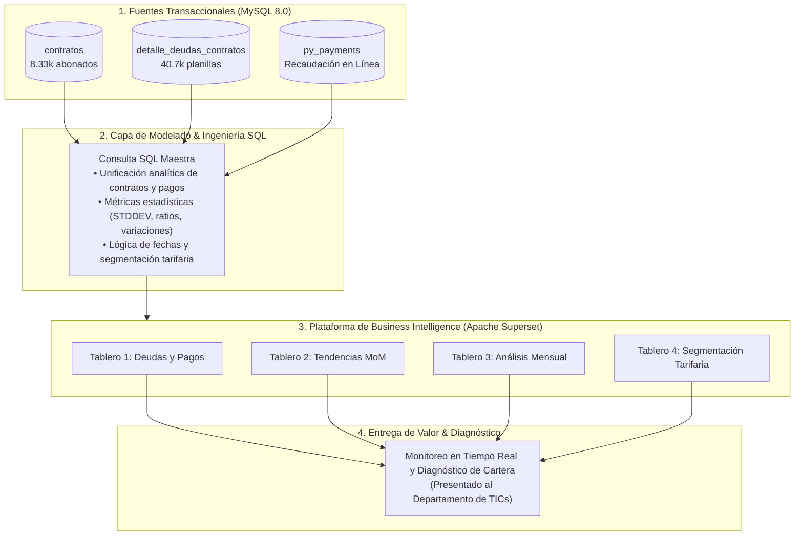
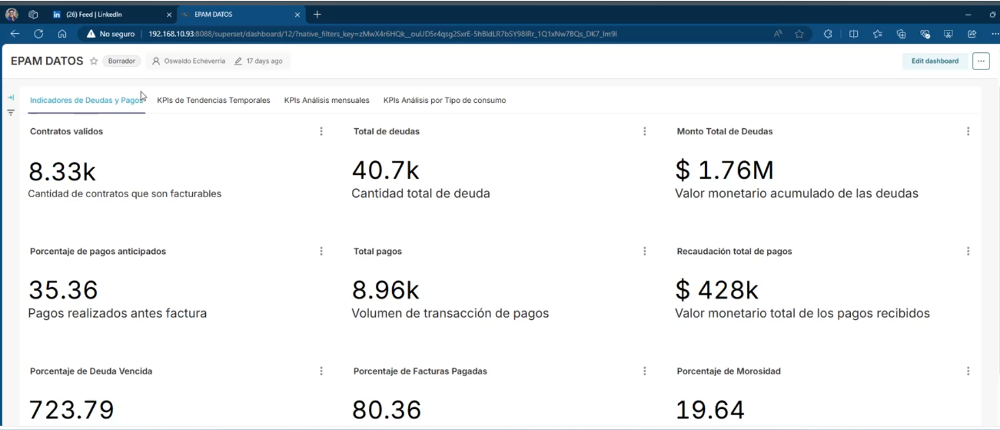
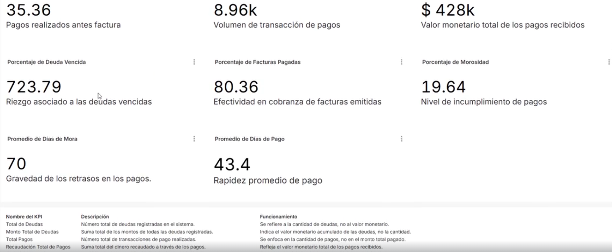
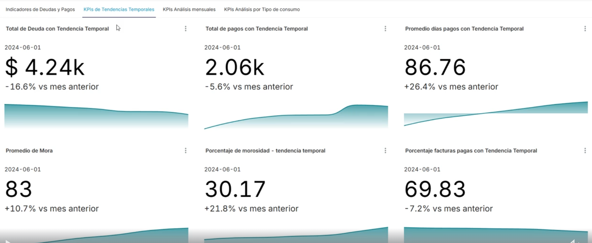
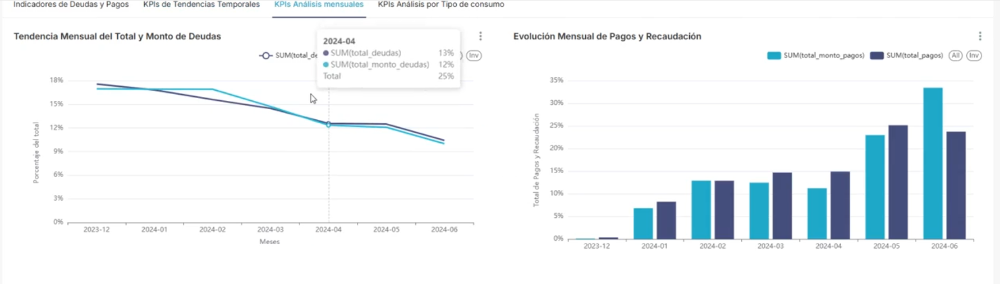
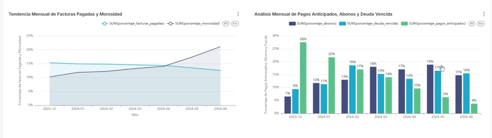
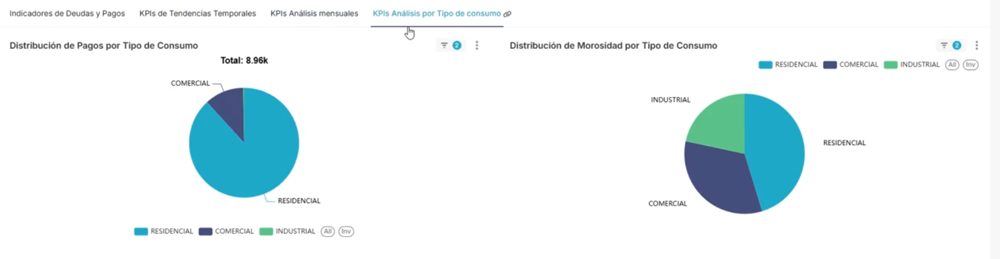
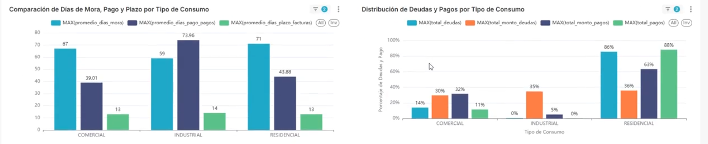

# 💧 Business Intelligence & Analítica de Recaudación en EPAM
### *Plataforma de Monitoreo de Indicadores de Cartera y Cobranza en Línea con Apache Superset*

<p align="center">
  
  
  
  
  
</p>

---

## 📌 Resumen Ejecutivo & Roles del Proyecto

Este proyecto documenta el diseño, modelado e implementación de una solución integral de **Business Intelligence (BI) y Analítica Descriptiva** desarrollada para la **Empresa Pública Aguas de Manta (EPAM)** en la ciudad de Manta, Ecuador.

A través de la integración de **Apache Superset** sobre un motor transaccional **MySQL 8.0**, se construyó una suite de tableros ejecutivos y operativos que unificó más de **40,700 registros de deuda**, **8,330 contratos activos** y un flujo transaccional de **$1.76M en cartera facturada**, transformando datos dispersos en una plataforma centralizada de monitoreo y diagnóstico en tiempo real.

### 👥 Equipo & Distribución de Responsabilidades
- **Oswaldo Echeverría — *Lead Data Engineer, BI Analyst & Desarrollador Principal*:**  
  Lideró y ejecutó el **100% del desarrollo técnico**:
  - Extracción, perfilado y modelado de datos sobre la base transaccional de EPAM (`portalepam`).
  - Creación y optimización de las consultas SQL analíticas complejas (cálculo de los 23 KPIs, agregaciones estadísticas con `STDDEV`, ventanas de tiempo y segmentación).
  - Despliegue, parametrización y conexión de **Apache Superset**.
  - Diseño integral de los tableros interactivos, gráficos de tendencias temporales (MoM) y análisis de tipo de consumo.
  - Análisis técnico y diagnóstico de cartera presentado al departamento de TICs.
- **Wellington Javier Alcívar Martínez — *Documentación Técnica & Co-investigador*:**  
  - Apoyo en el levantamiento documental de requerimientos, estructuración del informe académico de vinculación y compilación del marco referencial.

---

## 🎯 El Desafío Institucional (Situation & Task)

La Empresa Pública Aguas de Manta (EPAM) contaba con un importante ecosistema de recaudación en línea, pero enfrentaba desafíos técnicos y analíticos para su seguimiento:

1. **Silos de Información Transaccional:** La información de contratos, consumo métrico, planillas emitidas y transacciones de pasarelas de pago (`py_payments`) residía en esquemas normalizados diseñados para transacciones diarias, resultando lentos y complejos para consultas analíticas globales.
2. **Reportería Manual & Falta de Visibilidad:** La supervisión de recaudación dependía de consolidaciones manuales periódicas, dificultando la detección temprana de fluctuaciones en el comportamiento de pago o incrementos en la morosidad.
3. **Necesidad de Auditoría en Cartera:** Se requería identificar posibles discrepancias entre emisiones, estados de facturas y abonos parciales que pudieran distorsionar el panorama de la cartera exigible.

**Objetivo:** Desarrollar un sistema centralizado de Business Intelligence capaz de procesar **23 KPIs financieros, temporales y de comportamiento de pago**, visualizados en tableros interactivos como herramienta de soporte analítico para el área de tecnologías de la información (TICs) y la directiva de la empresa.

---

## 🏗️ Arquitectura de la Solución (Action)

El flujo técnico procesa los datos desde la capa transaccional hasta los tableros analíticos de manera desacoplada:



### Tecnologías Utilizadas
- **Business Intelligence & Visualización:** Apache Superset 3.x (Dashboards modulares con pestañas interactivas, filtros cruzados y visualizaciones ECharts).
- **Motor de Base de Datos:** MySQL 8.0 (Optimización analítica mediante subconsultas estructuradas y filtrado por rangos de fecha e índices de contratos).
- **Lenguaje Analítico:** SQL Avanzado (Agregaciones estadísticas, `STDDEV`, diferencias temporales con `DATEDIFF`, ratios de conversión y condicionales `CASE WHEN`).
- **Entorno de Despliegue:** Docker & Docker Compose para portabilidad y reproducibilidad.

---

## 📊 Recorrido Visual de los Tableros Implementados

La solución desarrollada se estructuró en 4 módulos analíticos mediante navegación interactiva en Apache Superset:

### 1. Indicadores Globales de Deudas y Recaudación
Monitoreo general de la cartera exigible, contratos activos y liquidez percibida.

<p align="center">
  
</p>

- **Contratos Válidos:** 8,330 contratos residenciales, comerciales e industriales facturables.
- **Monto Total de Deudas:** **$1.76M** acumulados en 40.7k planillas evaluadas.
- **Recaudación Efectiva en Línea:** **$428k** captados a través de 8.96k transacciones.
- **Tasa de Cobro de Facturas:** **80.36%** de efectividad en cobranza de emitidas.
- **Índice de Morosidad Global:** **19.64%** de incumplimiento general.
- **Comportamiento Anticipado:** 35.36% de los pagos se realizaron antes del corte de factura.

<p align="center">
  
</p>

*Métricas de gravedad:* Se identificó un **Promedio de Días de Mora de 70 días** para clientes en mora frente a un **Ciclo Promedio de Pago regular de 43.4 días**, acompañado por el diccionario de KPIs embebido directamente en el tablero para autoservicio de los usuarios.

---

### 2. KPIs de Tendencias Temporales (Mes a Mes / MoM)
Seguimiento dinámico con minigráficos (*sparklines*) de variabilidad contra el mes anterior.

<p align="center">
  
</p>

- **Total de Deuda Mensual:** $4.24k (-16.6% vs mes anterior).
- **Total de Pagos Procesados:** 2.06k transacciones (-5.6% vs mes anterior).
- **Días Promedio de Pago:** 86.76 días (+26.4% de dilatación vs mes previo).
- **Comportamiento de Morosidad:** Tasa de morosidad temporal calculada en **30.17%** (+21.8% vs mes anterior).

---

### 3. Dinámica Mensual y Cruces de Morosidad
Evolución cronológica desde diciembre 2023 hasta junio 2024.

<p align="center">
  
</p>

- **Lado Izquierdo:** Visualización de la trayectoria descendente del porcentaje de deuda acumulada con el fortalecimiento de los canales de pago.
- **Lado Derecho:** Crecimiento en el uso de los canales digitales, alcanzando su punto de mayor actividad en **junio de 2024 con más del 33% del recaudo semestral analizado**.

<p align="center">
  
</p>

- **Punto de Inflexión Detectado:** En abril de 2024 los datos reflejaron un cruce de curvas donde la morosidad mensual igualó y superó transitoriamente a la tasa de facturas pagadas.
- **Distribución de Hábitos:** Comparativa visual entre pagos anticipados (28% al inicio), abonos parciales y deuda vencida residual.

---

### 4. Segmentación por Tipo de Consumo (Residencial, Comercial, Industrial)

<p align="center">
  
</p>

<p align="center">
  
</p>

---

## 🔍 Diagnóstico e Insights Extraídos de los Datos (Results & Analysis)

El desarrollo del modelo analítico permitió identificar patrones de comportamiento financiero que previamente no eran visibles:

### 1. La Concentración de Cartera en el Sector Industrial
- **El Hallazgo:** El sector **Industrial** representa **menos del 1% del volumen de transacciones cotidianas**, pero concentra el **35% del monto total de deuda de toda la cartera evaluada**.
- **La Dilatación de Cobro:** El ciclo promedio de pago en clientes industriales alcanzó **73.96 días**, frente a los 39.01 días del sector comercial y 43.88 días del sector residencial.
- **Valor Diagnóstico:** Los datos demostraron cuantitativamente que una gestión de cobranza focalizada en un grupo reducido de cuentas industriales tenía un potencial de recuperación de cartera equivalente a miles de gestiones residenciales.

### 2. Identificación de Discrepancias y Deudas Residuales
- Las consultas del modelo detectaron casos en los que planillas registraban saldo pendiente pese a existir registros de transacciones en pasarelas digitales, proveyendo un insumo técnico útil para procesos de conciliación y auditoría de sistemas.

### 3. Reducción de Tiempos de Acceso a la Información
- Se validó técnicamente que la plataforma redujo la necesidad de procesamiento manual de reportes de varios días a consultas interactivas de **menos de 2 segundos** en Apache Superset.

---

## 💻 Consulta SQL Analítica Maestra (Extracto)

El cálculo unificado se construyó mediante agregaciones estadísticas nativas de alto rendimiento:

```sql
SELECT 
    -- 1. KPIs Generales de Deuda
    d.total_deudas,
    d.total_monto_deudas,
    d.desviacion_estandar_montos_deudas,
    d.promedio_monto_deuda_por_contrato,
    
    -- 2. KPIs Generales de Recaudación / Pagos
    p.total_pagos,
    p.total_monto_pagos,
    p.desviacion_estandar_montos_pagos,
    p.promedio_monto_pago_por_contrato,
    
    -- 3. Métricas de Eficiencia, Cartera y Morosidad
    ROUND((d.total_deuda_vencida / NULLIF(d.total_deudas, 0)) * 100, 2) AS porcentaje_deuda_vencida,
    ROUND((d.total_monto_deudas / NULLIF(d.total_clientes_con_deuda, 0)), 2) AS promedio_monto_deuda_por_cliente,
    ROUND((p.total_monto_pagos / NULLIF(p.total_clientes_que_han_pagado, 0)), 2) AS promedio_monto_pago_por_cliente,
    
    -- 4. KPIs de Facturación y Cumplimiento
    d.total_facturas,
    d.total_facturas_pagadas,
    d.porcentaje_facturas_pagadas,
    p.promedio_dias_pago AS promedio_dias_pago_pagos,
    d.promedio_dias_plazo_facturas,
    d.porcentaje_morosidad,
    
    -- 5. Métricas Estadísticas de Comportamiento de Pago
    p.promedio_dias_mora,
    p.desviacion_estandar_dias_mora,
    p.promedio_monto_deuda,
    p.promedio_monto_pago,
    p.porcentaje_pagos_anticipados,
    p.porcentaje_abonos
FROM subconsulta_deudas d, subconsulta_pagos p;
```
*(El script completo con sus subconsultas, conversiones y filtros está disponible en [`sql/kpis_recaudacion_maestro.sql`](sql/kpis_recaudacion_maestro.sql)).*

---

## 🔒 Confidencialidad y Privacidad de Datos (LOPDP Compliant)

En estricto cumplimiento con la **Ley Orgánica de Protección de Datos Personales (LOPDP) del Ecuador** y las políticas de confidencialidad institucional de la EPAM:
- Ningún dato personal (nombres, identificaciones, correos, medidores o cuentas bancarias reales) está expuesto en este repositorio público.
- Se incluye un script de prueba reproducible en [`sql/schema_mock.sql`](sql/schema_mock.sql) con datos sintéticos para validar el funcionamiento técnico de las consultas sin vulnerar información reservada.

---

## 🚀 Reproducibilidad del Proyecto Localmente

```bash
# 1. Clonar el repositorio
git clone https://github.com/oswaldoecheverria/epam-bi-superset-analytics.git
cd epam-bi-superset-analytics

# 2. Levantar la base de datos de pruebas (MySQL 8.0)
mysql -u root -p < sql/schema_mock.sql

# 3. Ejecutar la consulta de KPIs analíticos
mysql -u root -p portalepam_mock < sql/kpis_recaudacion_maestro.sql
```

---

## 🤝 Reconocimientos Institucionales

Expreso mi agradecimiento a las autoridades, profesionales y docentes que respaldaron y guiaron este proyecto de vinculación e investigación:

- **Ing. Israel Julio Gómez, MG.** — *Encargado del área de tecnologías en el departamento de TICs de EPAM*, por su liderazgo, visión y apertura para facilitar la investigación aplicada en los sistemas de la empresa.
- **Ing. Henry Neurio Mero Briones, MG.** — *Tutor Académico*, por su asesoría y orientación técnica continua.
- **Ing. Robert Wilfrido Moreira Centeno, MG.** — *Co-tutor*, por su valioso acompañamiento metodológico.
- A la **Empresa Pública Aguas de Manta (EPAM)** y a la **Universidad Laica Eloy Alfaro de Manabí (ULEAM)** por impulsar espacios de vinculación técnica de alto nivel.

---

<p align="center">
  <b>Desarrollado por Oswaldo Echeverría</b><br />
  <i>Lead Data Engineer · BI Analyst · SQL Analytics</i>
</p>
